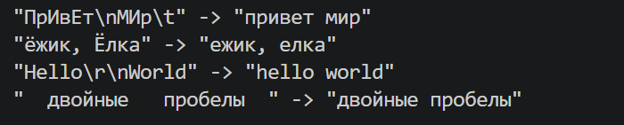
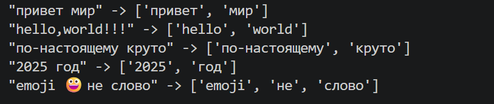
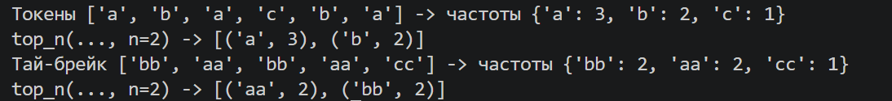
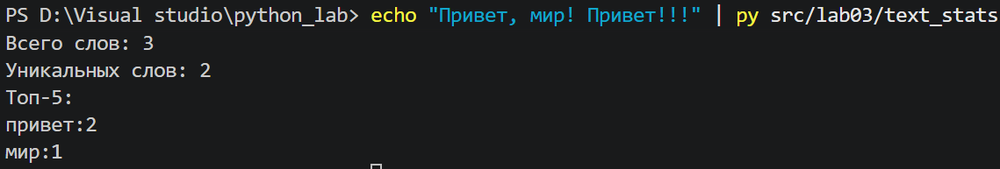

# python_lab

# Лабораторная работа 3 — Тексты и частоты слов (словарь/множество)
## Задание A

## `normalize`

```python
def normalize(text: str, *, casefold: bool = True, yo2e: bool = True) -> str:
    """Функция приводит текст к единому регистру и убирает пробелы."""
    if casefold:
        text = text.casefold()
    else:
        text = text.lower()
    if yo2e:
        text = text.replace("ё", "е").replace("Ё", "Е")
    text = re.sub(r"\s+", " ", text)
    return text.strip()
```


## `tokenize`
```python
def tokenize(text: str) -> list[str]:
    """Функция считывает из текста слова, включая слова с дефисом и числа."""
    return re.findall(r"\w+(?:-\w+)*", text)
```


## `count_freq и top_n`
```python
def count_freq(tokens: list[str]) -> dict[str, int]:
    """Функция возвращает словарь с количеством каждого слова."""
    freq: dict[str, int] = {}
    for token in tokens:
        freq[token] = freq.get(token, 0) + 1
    return freq
```


## Задание В

```python
import os
import sys

sys.path.insert(
    0, os.path.abspath(os.path.join(os.path.dirname(__file__), ".."))
)

from lib.text import count_freq, normalize, tokenize, top_n


def main():
    sys.stdin.reconfigure(encoding='utf-8')
    text = sys.stdin.read()
    if not text:
        return
    
    tokens = tokenize(normalize(text))
    freq = count_freq(tokens)
    top5 = top_n(freq, n=5)

    print(f"Всего слов: {len(tokens)}")
    print(f"Уникальных слов: {len(freq)}")
    print("Топ-5:")
    for word, count in top5:
        print(f"{word}:{count}")


if __name__ == "__main__":
    main()
```
