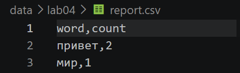
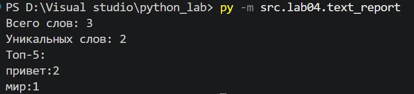
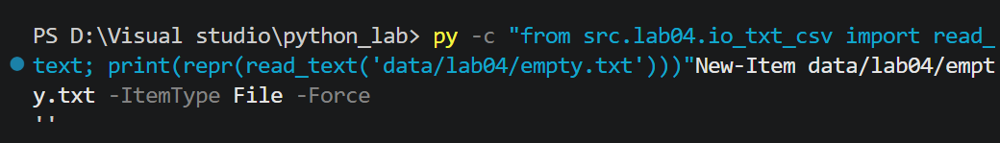
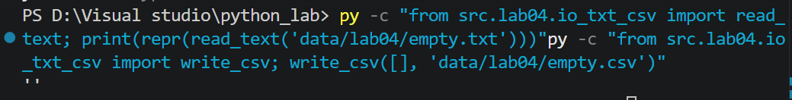
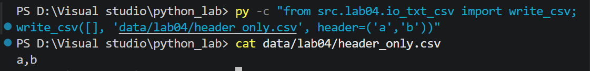
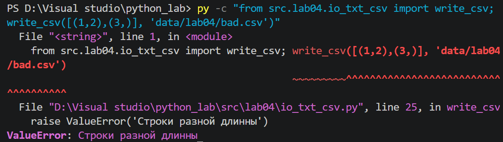
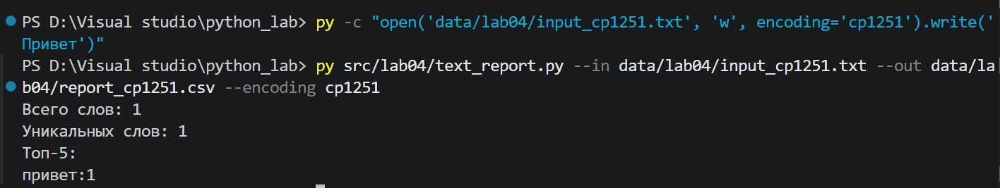

## python_lab #

## Лабораторная работа №4

#### Задание А

#### `read_text`
```python
def read_text(path: str | Path, encoding: str = "utf-8") -> str:
    """Открывает файл и читает в заданной кодировке.

    По умолчанию кодировка UTF-8. Для другой кодировки укажите encoding,
    например: read_text("data/lab04/input.txt", encoding="cp1251").

    Raises:
        FileNotFoundError: если файл не найден.
        UnicodeDecodeError: если файл нельзя прочитать в этой кодировке.
    """
    p = Path(path)
    return p.read_text(encoding=encoding)
```

Функция читает файл и возвращает его как одну строку. Для этой лабораторной работы такой подход допустим, но в реальных проектах большие файлы лучше читать построчно, чтобы не занимать много оперативной памяти.
Если файл не найден, возникает FileNotFoundError. При несовпадении кодировки возникает UnicodeDecodeError.


---

#### `write_csv`
Функция записывает строки в CSV-файл. Перед записью проверяется, что все строки имеют одинаковую длину. Если длины отличаются, вызывается ошибку.
```python
def write_csv(
        rows: Iterable[Sequence],
        path: str | Path,
        header: tuple[str, ...] | None = None
) -> None:
    """Создаёт или перезаписывает CSV-файл"""
    if rows:
        etalon = len(rows[0])
        for r in rows:
            if len(r) != etalon:
                raise ValueError('Строки разной длинны')
    p = Path(path)
    ensure_parent_dir(p)
    rows = list(rows)
    with p.open("w", newline="", encoding="utf-8") as f:
        w = csv.writer(f)
        if header is not None:
            w.writerow(header)
        for r in rows:
            w.writerow(r)
```
---

#### `ensure_parent_dir`

Функция проверяет наличие родительской папки и создает ее вместе со всеми отсутствующими вложенными папками.

```python
def ensure_parent_dir(path: str | Path) -> None:
    """Создать родительские директории, если их нет."""
    p = Path(path)
    p.parent.mkdir(parents=True, exist_ok=True)
```

#### Задание В

```python
import sys
from pathlib import Path
import argparse

current_dir = Path(__file__).resolve().parent
src_dir = current_dir.parent
if str(src_dir) not in sys.path:
    sys.path.append(str(src_dir))
from lib.text import normalize, tokenize, count_freq, top_n
from lab04.io_txt_csv import read_text, write_csv

def sorted_word_counts(freq: dict[str, int]) -> list[tuple[str, int]]:
    """Сортировка пар (word, count)"""
    return sorted(freq.items(), key = lambda kv: (-kv[1], kv[0]))

def main():
    parser = argparse.ArgumentParser(description="Генерация частотного отчёта")
    parser.add_argument("--in", default="data/lab04/input.txt", dest="input_file")
    parser.add_argument("--out", default="data/lab04/report.csv", dest="output_file")
    parser.add_argument("--encoding", default="utf-8")
    
    args = parser.parse_args()
    input_path = Path(args.input_file)
    output_path = Path(args.output_file)
    text = read_text(input_path, encoding=args.encoding)
   
    tokens = tokenize(normalize(text))
    freq = count_freq(tokens)
    sorted_rows = sorted_word_counts(freq)

    header = ("word", "count")
    write_csv(sorted_rows, output_path, header=header)

    print(f"Всего слов: {len(tokens)}")
    print(f"Уникальных слов: {len(freq)}")
    print("Топ-5:")
    for word, count in top_n(freq, 5):
        print(f"{word}:{count}")
if __name__ == "__main__":
    main()
```

## Тест-кейсы

Вход `data/lab04/input.txt:` Привет, мир! Привет!!!

Консоль: 



`report.csv`:



### Краевые случаи
---
1. Пустой файл -> пустая строка
```powershell
New-Item data/lab04/empty.txt -ItemType File -Force
py -c "from src.lab04.io_txt_csv import read_text; print(repr(read_text('data/lab04/empty.txt')))"
```

---
2. Пустой rows, без заголовка -> пустой файл
```powershell
py -c "from src.lab04.io_txt_csv import write_csv; write_csv([], 'data/lab04/empty.csv')"
Get-Item data/lab04/empty.csv
```

---
3. Пустой rows с заголовком -> только заголовок
```powershell
py -c "from src.lab04.io_txt_csv import write_csv; write_csv([], 'data/lab04/header_only.csv', header=('a','b'))"
cat data/lab04/header_only.csv
```

---
4. Строки разной длины -> ValueError
```powershell
py -c "from src.lab04.io_txt_csv import write_csv; write_csv([(1,2),(3,)], 'data/lab04/bad.csv')"
```


### Тест C. Нестандартная кодировка

```powershell
py -c "open('data/lab04/input_cp1251.txt', 'w', encoding='cp1251').write('Привет')"
```

```powershell
py src/lab04/text_report.py --in data/lab04/input_cp1251.txt --out data/lab04/report_cp1251.csv --encoding cp1251
```
