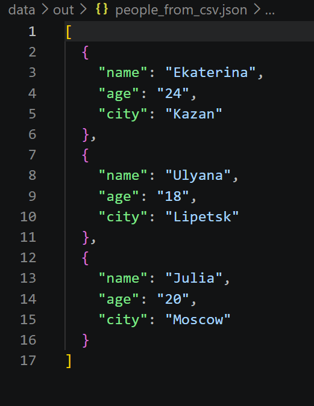
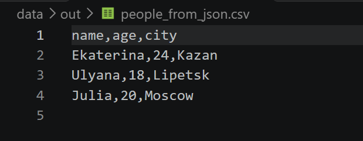
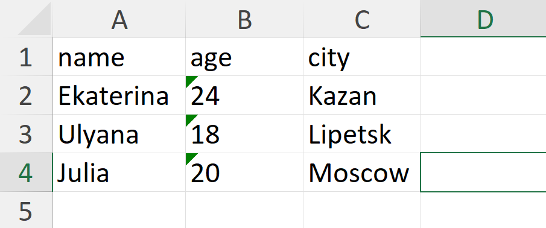

# Отчет по лабораторной работе 5

## Задание A — JSON ↔ CSV

### Функция `json_to_csv`

Преобразует JSON-файл (список словарей) в CSV-таблицу.

```python
def json_to_csv(json_path: str, csv_path: str)-> None:
    jp = Path(json_path)
    cp = Path(csv_path)
    if not jp.exists():
        raise FileNotFoundError("Указанный JSON файл не найден")
    if jp.suffix.lower() != '.json':
        raise ValueError("Указанный файл не формата JSON")
    with jp.open('r', encoding = 'utf-8') as p:
        try:
            data = json.load(p)
        except json.JSONDecodeError:
            raise ValueError("Пустой JSON или неподдерживаемая структура")
    if not isinstance(data, list) or len(data) == 0:
        raise ValueError('Файл JSON пустой или имеет неправильный формат')
    if not all(isinstance(item, dict) for item in data):
        raise ValueError("Все элементы списка JSON должны быть словарями")

    ensure_parent_dir(cp)

    fieldnames = {}
    for element in data:
        for key in element.keys():
            fieldnames[key] = None

    with cp.open('w', newline="", encoding='utf-8') as f:
        w = csv.DictWriter(f, fieldnames=list(fieldnames.keys()))
        w.writeheader()
        w.writerows(data)
```

Собирает объединение всех ключей из всех словарей списка для формирования заголовков таблицы (fieldnames).

Отсутствующие поля в отдельных объектах автоматически заполняются пустыми строками.

Проверяет существование файла, корректность расширения .json, структуру данных (должна быть непустым списком словарей).

### Функция `csv_to_json`

Преобразует CSV-таблицу в JSON-файл (список словарей).

```python
def csv_to_json(csv_path: str, json_path: str) -> None:
    '''Записывает значения
    Args:
        csv_path: Путь к csv файлу из которого читаем
        json_path: Путь к json файлу куда пишем
    Returns: 
        None
    Raises:
        FileNotFoundError: 
            Указанный CSV файл не найден
        ValueError:
            Указанный файл не формата CSV
            Файл CSV пустой
            Файл CSV не содержит данных
    '''
    jp = Path(json_path)
    cp = Path(csv_path)
    if not cp.exists():
        raise FileNotFoundError("Указанный CSV файл не найден")
    if cp.suffix.lower() != '.csv':
        raise ValueError("Указанный файл не формата CSV")
    
    with cp.open("r", newline="", encoding="utf-8") as f:
        reader = csv.DictReader(f)
        if reader.fieldnames is None:
            raise ValueError("Файл CSV пустой")
        data = list(reader)
    if not data:
        raise ValueError("Файл CSV не содержит данных")
    ensure_parent_dir(jp)

    with jp.open('w', encoding='utf-8') as p:
        json.dump(data, p, ensure_ascii=False, indent=2)
```
### Особенности работы:

Использует внешнюю библиотеку openpyxl.

Создает рабочую страницу с именем "Sheet1".

Первая строка CSV записывается как заголовок таблицы.

Расчет ширины колонок выполняется автоматически на основе максимальной длины строкового представления значений в каждой колонке, но не менее 8 символов (max(max_len, 8)).

## Задание B — CSV → XLSX

Конвертирует данные из формата CSV в документ XLSX.

```python
def csv_to_xlsx(csv_path: str, xlsx_path: str) -> None:
    cp = Path(csv_path)
    xlp = Path(xlsx_path)

    if not cp.exists():
        raise FileNotFoundError("Указанный CSV файл не найден")
    if cp.suffix.lower() != '.csv':
        raise ValueError("Указанный файл не формата CSV")

    with cp.open('r', newline='', encoding='utf-8') as f:
        reader = list(csv.reader(f))
    if not reader:
        raise ValueError("Файл CSV пустой")

    wb = Workbook()
    ws = wb.active
    assert ws is not None
    ws.title = "Sheet1"

    for row in reader:
        ws.append(row)

    for col in ws.columns:
        max_len = 0
        letter = col[0].column_letter
        for cell in col:
            if cell.value and len(str(cell.value)) > max_len:
                max_len = len(str(cell.value))
        ws.column_dimensions[letter].width = max(max_len, 8)

    ensure_parent_dir(xlp)
    wb.save(xlp)
```

## Примеры данных и результаты

Для демонстрации используются следующие файлы:

- `data/lab05/samples/people.json` — список людей в формате JSON;
- `data/lab05/samples/people.csv` — те же данные в формате CSV;
- `data/lab05/samples/cities.csv` — дополнительный CSV с городами;
- `data/lab05/out/people_from_json.csv` — результат JSON → CSV;
- `data/lab05/out/people_from_csv.json` — результат CSV → JSON;
- `data/lab05/out/people.xlsx` — результат CSV → XLSX.

### Команды для запуска:

1. JSON ↔ CSV:
```powershell
python -m src.lab05.json_csv
```


*Результат преобразования CSV в JSON.*



*Результат преобразования JSON в CSV.*

2. CSV → XLSX:
```powershell
python -m src.lab05.csv_xlsx
```


\
*Результат преобразования CSV в XLSX.*

## Обработка ошибок

Входные функции явно сообщают об ошибках:

- `FileNotFoundError` - файл по указанному пути не существует - `"Указанный JSON/CSV файл не найден"`
- `ValueError` - передан файл с неверным расширением (например, `.txt` вместо `.json`) - `"Указанный файл не формата JSON/CSV"`
- `ValueError` - JSON-файл имеет синтаксическую ошибку или пуст - `"Пустой JSON или неподдерживаемая структура"` 
- `ValueError` - Элементы JSON-списка не являются словарями - `"Все элементы списка JSON должны быть словарями"`
- `ValueError` - CSV-файл полностью пустой - `"Файл CSV пустой"`