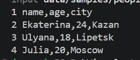
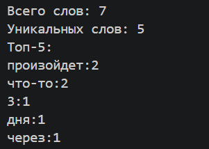
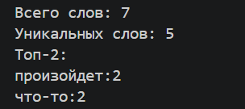
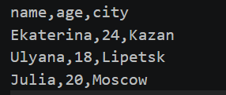
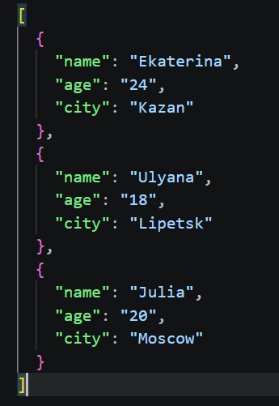
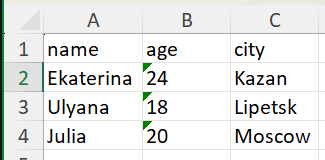
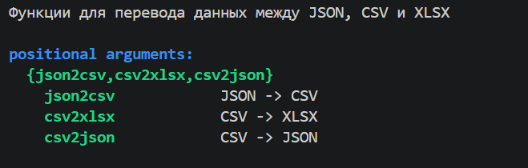
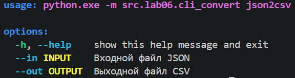
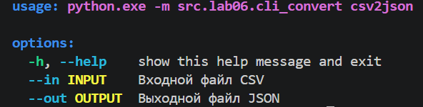
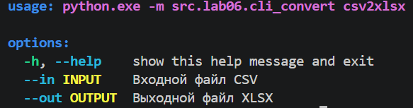

# Лабораторная работа №6
## Припадчева Ульяна Сергеевна

В рамках данной лабораторной работы были созданы две консольные CLI-утилиты на базе стандартного модуля `argparse`:
1. `cli_text.py` — утилита для построчного вывода файлов (`cat`) и частотного анализа текста (`stats`).
2. `cli_convert.py` — утилита для конвертации табличных данных между форматами JSON, CSV и XLSX (с использованием функций из ЛР5).

---

### `cli_text.py`

`cat`

```python
def cat_command(input_path: str, numbers: bool = False) -> None:
    path = Path(input_path)\

    if not path.is_file():
        raise FileNotFoundError("Файл не найден")

    with open(path, "r", encoding='utf-8') as f:
        for num, line in enumerate(f, start=1):
            if numbers:
                print(f"{num} {line}", end = "")
```

`stats`

```python
def stats_command(input_path: str, top: int = 5) -> None:
    path = Path(input_path)

    if not path.is_file():
        raise FileNotFoundError("Файл не найден")

    text = read_text(input_path)

    tokens = tokenize(normalize(text))
    freq = count_freq(tokens)

    total_words = len(tokens)
    unique_words = len(freq)
    top_words = top_n(freq, top)

    print(f'Всего слов: {total_words}')
    print(f'Уникальных слов: {unique_words}')
    print(f'Топ-{top}:')
    for w, c in top_words:
        print(f"{w}:{c}")
```

`main()`

```python
def main():
    parser = argparse.ArgumentParser(description="CLI-утилиты для работы с текстом")
    subparsers = parser.add_subparsers(dest="command", required=True)

    # Подкоманда cat
    cat_parser = subparsers.add_parser("cat", help="Выводит содержимое файла построчно")
    cat_parser.add_argument("--input", required=True, help="Путь к входному текстовому файлу")
    cat_parser.add_argument("-n", action="store_true", help="Выводить номера строк")

    # Подкоманда stats
    stats_parser = subparsers.add_parser("stats", help="Анализ частот слов в тексте")
    stats_parser.add_argument("--input", required=True, help="Путь к входному текстовому файлу")
    stats_parser.add_argument("--top", type=int, default=5, help="Количество слов в топе (по умолчанию 5)")

    args = parser.parse_args()

    if args.command == "status" and args.top < 1:
        parser.error("--top должен быть больше 0")

    try:
        if args.command == "cat":
            cat_command(args.input, args.n)
        elif args.command == "stats":
            stats_command(args.input, args.top)

    except FileNotFoundError:
        parser.error(f"Файл не найден: {args.input}")
    except UnicodeDecodeError:
        parser.error(f"Файл {args.input} написан в кодировке, отличной от UTF-8")

if __name__ == "__main__":
    main()
```

### Тесты:

`Модуль cli_text.py`

Команда cat с нумерацией строк (-n):

```powershell
py -m src.lab06.cli_text cat --input data/samples/people.csv -n
```



Команда stats без указания топом:

```powershell
py -m src.lab06.cli_text stats --input data/lab04/input.txt
```



Команда stats с заданным размером топа:

```powershell
py -m src.lab06.cli_text stats --input data/lab04/input.txt --top 2
```



Вывод справки:

```powershell
py -m src.lab06.cli_text --help
py -m src.lab06.cli_text cat --help
py -m src.lab06.cli_text stats --help
```

`Модуль cli_convert.py`

Вывод справки:

```powershell
py -m src.lab06.cli_convert --help
py -m src.lab06.cli_convert json2csv --help
```

Конвертация JSON в CSV:

```powershell
py -m src.lab06.cli_convert json2csv --in data/samples/people.json --out data/out/people.csv
```



Конвертация CSV в JSON:

```powershell
py -m src.lab06.cli_convert csv2json --in data/samples/people.csv --out data/out/people.json
```



Конвертация CSV в XLSX:

```powershell
py -m src.lab06.cli_convert csv2xlsx --in data/samples/people.csv --out data/out/people.xlsx
```



Вывод справки:

Общая справка по всем подкомандам:



Справка по json2csv:



Справка по csv2json:



Справка по csv2xlsx:



### Обработка ошибок:

`FileNotFoundError` — если файл по указанному пути не найден.

`UnicodeDecodeError` — если файл сохранен в кодировке, отличной от UTF-8.

Неверные параметры перехватываются парсером с выводом справки.